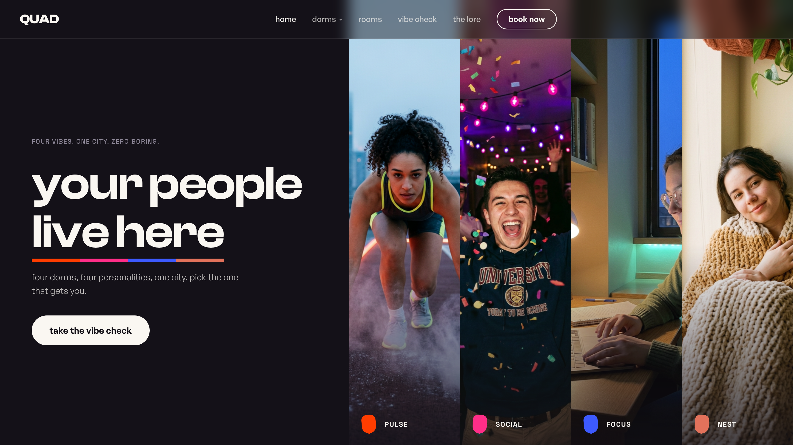

# QUAD

**A twelve-page marketing site for a fictional student-housing brand with four distinct dorm personalities.**
QUAD is a fictional brand in the fictional city of Northaven: one brand, four dorms —
**Pulse** (athletes), **Social** (extroverts), **Focus** (deep-workers), **Nest** (homebodies) —
each fully staged in its own color world, from the hero video down to the "vibe check" quiz
that matches visitors to the one that fits.

> *Four vibes. One city. Zero boring.*

**Live:** [quad-ochre.vercel.app](https://quad-ochre.vercel.app)



*Concept / portfolio project. QUAD is a fictional brand; the imagery is AI-generated.*

---

## The idea

Twelve pages built around one bit: **same brand, four completely different worlds.** Every
dorm gets its own palette, shield mark and voice — Pulse is a gym-red night shift, Nest is the
only page in daylight. A teaser quiz on the home page and a dedicated Vibe Check page (eight
questions, one take-back) match visitors to their dorm; room pages let you flip the same room
through all four flavors and remember your pick.

- **Ink** `#141118` (page) · **Paper** `#FAF7F2` (light sections)
- **Pulse** `#FF3D00` · **Social** `#FF2E88` · **Focus** `#3D5AFE` · **Nest** `#E2725B`
- **Clash Display** (headings) + **General Sans** (body) + **Space Grotesk** (labels, tabular
  numerals)

## Sections

Home (hero + teaser quiz + rooms digest) · Pulse / Social / Focus / Nest (dorm takeovers) ·
Room pages — Single / Twin / Double (four-flavor switcher) · Vibe Check (8-question quiz +
comparison table) · The Lore (scroll-pinned origin story + city map) · Book (demo booking
flow) · Contact.

## Built with

**Plain HTML, CSS, and JavaScript. No framework, no dependencies, no build step.** Open
`index.html` and it runs.

- Scroll reveals, parallax, the "day at X" scrollytelling and divider travelers — all vanilla
  scroll listeners + `requestAnimationFrame`, no GSAP.
- Room flavor persists per visitor via `localStorage`, applied before first paint (no flash).
- Every animation has a `prefers-reduced-motion` fallback; glass surfaces fall back to opaque
  under `prefers-reduced-transparency`.
- Mobile nav is a small custom element: fullscreen overlay, Escape to close, focus returns to
  the toggle button.
- **Self-hosted assets:** woff2 fonts, solid dorm-colored shield SVGs, muted hero video loops
  with poster fallback.

## Run it locally

Any static file server works — no tooling required:

```bash
python3 -m http.server 8000
# then open http://localhost:8000
```

## Structure

```
index.html                           # home
pulse.html / social.html /           # dorm takeover pages
  focus.html / nest.html
room-single.html / room-twin.html /  # room pages (dorm flavor switcher)
  room-double.html
vibe-check.html                      # 8-question quiz + comparison table
lore.html                            # origin story + city map
book.html                            # demo booking flow
contact.html                         # contact form
styles.css                           # design tokens + every page's styles
quad.js                              # nav/footer inject, scroll motion, room switcher
quad-nav.js                          # mobile nav web component
assets/                              # fonts, images, video loops, dorm shields
```
